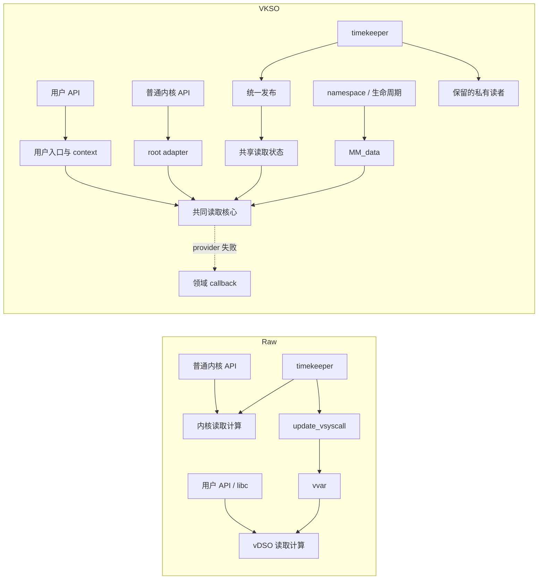

# Clocktime：实现复用、规模与维护证据

> 本目录保留性能实验版本 `cf9dc817` 的证据。2026-10-09适配精简见[审查与决策](../CHANGE_AUDIT.md#2026-10-09适配精简与计数边界)和[当前增量报告](../adapter-evidence/report.json)。包含保留读取/分派后，Raw为1,578行，原VKSO为1,771行，精简后为1,708行。本文的“当前”指该目录固化时的实验版本；重放存量审计使用 `audit_current.py --check --historical`，不认证精简后的源码为原性能版本。


本目录固化工作 1、2 的结果。研究对象是 Linux 5.15.198、x86-64 LP64 的 clocktime 实现及单列的 getcpu 功能，VKSO 生产源码版本为 `cf9dc817f29f9c8d6f88dde0c58c4ccb75347aeb`。二进制来自 `20260929T040650Z-clocktime-full` 的两种 clean READ 实验包。性能结果不在本目录分析。

入口：数值见 [tables.md](tables.md)，逐接口范围见 [interfaces.csv](interfaces.csv)，复用路径见 [mechanism.mmd](mechanism.mmd)，完整复算方法见本文末尾。

## 结果与可支持的结论

用户入口与 8 个纳入范围的普通内核读取入口进入共同的高精度或粗粒度实现；另外 3 个内核标量入口直接读取共享状态。时钟分类、地址空间依赖、输出 ABI 和失败完成方式由两侧适配。特殊内核读者与不支持 provider 的私有计算仍保留。

匹配职责清单中的功能实现为 Raw **1,487**、VKSO **1,624** 行，增加 **137** 行；计入单列的保留读取/分派切片后分别为 **1,578**、**1,771** 行。这是以共同 Linux/libc 设施为边界的功能源码存量，不是整个 Linux 或应用依赖闭包的规模。源码类别、边界和逐行依据都在本目录。集成改动账仍为新增 1,477、删除 340、净增 1,137 行，两种统计回答不同问题。

两种配置各 4 次正式裸机启动的已记录共享 text/data 页均具有相同的用户与内核 PFN。实际构建的 carrier 尾跳转和内核调用目标同时指向共享入口。该证据支持跨域执行复用；Raw vDSO 本来就在用户进程间共享，不能由此推导总体内存节约。

真实维护提交 `aa1855e` 修改了一个共同 cycle-delta 实现及其调用位置，共 2 个生产函数、1 个测试函数，两侧入口和状态发布无需修改。前后 helper 在 100,100 组全宽输入上结果一致；当前生产读取核心与适配的 9 项主机契约测试通过。它展示共同计算的集中维护，不提供工时或普遍的“修改点减少一半”结论。

## 工作 1：职责、路径与实际执行

| 职责 | 实现位置与边界 | 证据 |
| --- | --- | --- |
| 共同计算 | `vkso_read_hres_time`、`vkso_read_begin/retry`、`vkso_cycle_delta`、`vkso_read_coarse`、`vkso_apply_offset`；共享 hres/coarse、getres、gettimeofday、time/getcpu 入口 | `source-lines.csv`；`binary-symbols.csv` 的 `kernel-shared-core` |
| 用户适配 | 公共 API/errno、初始化、clock ID 分类、绑定用户 context/MM_data、carrier 尾跳转和 syscall fallback | `functional/vkso_user_entry.S`、`vkso_user_wrapper.c`、`direct-api/vkso_public.c`、`vkso_time_init.c`；`binary-user-transfers.csv` |
| 内核适配 | 固定时钟绑定 root 语义；动态 POSIX 分派使用当前 MM_data；返回类型转换；provider 失败由 kernel callback 完成一次私有读取 | `include/linux/vkso_time.h`、`timekeeping.c`、`posix-timers.c`、`time.c`；`kernel-contract-validation.log` |
| 状态发布 | `tk_publish_read_state` 从 timekeeper 派生共享读取状态并以序列协议发布；timezone/provider context 另有更新入口 | `source-slices.csv` 的 publisher 行；内联发布体的二进制归属见 `host_container` |
| 映射和生命周期 | 代码/data backing 由通用注册设施提供；`arch/x86/kernel/vkso.c` 安装只读 MM_data，维护引用，切换 namespace backing 与 PTE | 通用设施清单；`mechanism-boots.csv`、`shared-pages.csv`；namespace/exec/setns 日志 |
| 保留部分 | 不支持的 provider、NMI/fast、snapshot、持锁及其他未改接共享核心的读者 | `interfaces.csv` 的 `private_retained`；源码表的 retained 分类 |

`interfaces.csv` 明确区分 `shared_code`、`shared_state_only`、`private_retained` 和 `domain_fallback`，也标明源码、主机测试、裸机测试分别覆盖什么。固定时钟路径的 `NULL MM_data` 表示 root 语义；namespace 偏移不是所有内核读取都应用的规则。

机制图的 Mermaid 源文件可直接嵌入 Markdown。实线表示调用或数据输入，虚线表示失败分支和生命周期操作。Raw 的原始循环与 VKSO 的共享核心仍使用共同数学/provider 基础，不把通用 helper 的存在误当成重复实现。



8 份 PFN 记录对应 Retpoline 每次 2 个 text 页、1 个 data 页，以及 no-retpoline 每次 1 个 text 页、1 个 data 页。Retpoline 的额外映射 text 页包含共享的通用 thunk；共同时间/getcpu 核心本身在两配置都预留 4 KiB。用户私有入口页不是共享核心。

PFN 是映射身份检查；执行路径由源码、实际内核/DSO 转移指令、公开 API 和选定快路径 syscall denial 共同支撑。裸机结果对应 TSC 环境，不能据此声称 PVClock/Hyper-V 已做裸机运行验证。主机 provider-failure 测试使用环境夹具，也不代替真实虚拟化平台测试。

## 工作 2A：同功能规模及适配成本

清单按职责选定当前函数和结构范围，主表覆盖七类共享 clock ID、公开时间 API、11 个列明的内核入口、native/provider fallback 接入、状态发布、namespace/映射与构建。getcpu 专属行另列；“去除 getcpu 专属行”的时间小计保留双方共用的头文件、初始化和构建，不按用途任意摊分公共行。

计数单位是非空非注释的物理源码行，包括声明、括号、预处理指令和生产 ABI 断言。每个方案中的每个源位置只有一个主归属。宏/inline 的一次源码定义只计一次；这不意味着编译器只能产生一处专门化或内联机器码。

源码存量表与改动账分别保留。前者包括原有、保留及新增实现，后者记录集成新增/删除；不能用净增代替当前存量，也不能将额外移除 IA32、UML、SGX 支持解释为相同功能的算法节约。

| 边界 | 处理方式 |
| --- | --- |
| Raw 普通内核 reader | 完整列入相同 11 个接口及其计算 helper，不再整体归为外部依赖 |
| 混合职责函数 | 以主职责归类，Raw 原 reader 同时包含计算与 ABI；类别行不能直接相减解释为纯算法缩减 |
| VKSO 私有 fallback 与特殊读者 | 另列 retained；同时给出功能 + 保留切片小计。特殊读者行是列明的接口根，不代表整个内核依赖闭包 |
| namespace | 双方使用完整分配、释放、冻结、commit、fork 函数，包含不变的错误和锁路径；不以 VKSO 的改动行与 Raw 的完整函数比较 |
| 通用 timekeeper/NTP、锁、MM、动态链接器与 libc | 双方共同运行环境，单列依赖边界；保持原有设施，无整体内核/用户空间总量结论 |
| libc 用户侧入口 | Raw 使用已有 libc→vDSO 分派；VKSO 的公开库及初始化完整计入新增适配。双方仍依赖 libc，部署没有删除 libc 的原入口。`reference-glibc-2.35/` 保留未修改的入口/分派参考源，独立统计，不作为目标机发行版补丁身份认证，也不合入 LP64 功能小计 |
| 通用构建/注册设施 | Raw vdso2c/generic build 与 VKSO exporter、manager、module/protocol/owner 的所列完整文件另表计量，不假设摊销比例；编译器及全部工具链不计入 |
| 诊断和兼容代码 | 本清单涉及的 79 行诊断与 20 行 compat32 另列；完整集成诊断总量仍查原改动账，79 不是全部诊断代码规模 |

二进制取自正式实验包，通过采集记录中的镜像与库身份绑定。Raw 内核镜像已去普通符号表，工具从镜像内恢复 kallsyms，并以导出指针表交叉检查；VKSO 另与 GNU build-id 相同的完整 ELF 的五万余个函数地址核对。11 个内核入口使用统一的“到下一不同 text 符号的 extent”口径，包含对齐；vDSO 与共享函数体另报 ELF `st_size`。两者不混称精确指令字节。

共享函数体、共享页、carrier 页、公开库和完整内核段是重叠视图。共享 backing 在资源口径下只算一次。内联的 `tk_publish_read_state` 记录在包含公共 timekeeping 工作的宿主函数中，不将整个宿主归为发布专属成本，也不将缺少独立符号写成实现为零。

## 工作 2B：真实维护案例

任务：利用 x86 对用户可见 clocksource 的全宽计数器约束，去掉共享 cycle-delta 路径中的无效 mask 处理。历史提交为 `aa1855e`；[完整补丁](maintenance-aa1855e.patch)保留了改动原文和父版本身份。

| 位置 | 实际变化 | 需要同步的职责 |
| --- | --- | --- |
| `vkso_cycle_delta` | 删除 mask 参数及有限位宽分支，保留 backward clamp | 一个共同算法定义 |
| `vkso_read_hres_time` | 删除 mask 读取，更新 helper 调用 | 同一共同实现的调用位置 |
| `vkso_cycle_delta_selftest` | 更新 helper 参数与不支持 provider 的测试输入 | 测试需要同步维护 |
| 用户入口、内核 root adapter、publisher、MM_data | 本次无修改 | ABI 和 provider 契约未改变 |
| Raw `vdso_calc_delta` | 原本已采用全宽差值与 backward clamp | 此任务无需再改 vDSO |
| Raw `timekeeping_get_delta` 等 | 继续支持通用 clocksource 语义 | 不能直接套用用户可见全宽假设；维护更广语义时需独立判断 |

该案例表明共同计算的变更不需要在用户与内核入口中各实现一次。这里的“一份实现”包含 2 个关联生产函数，不是“只改一行”或“只改一个函数”。Raw 本例不能构成必改两处的反事实；因此不报告修改位置降低百分比。

从当前结构看，普通高精度读取的序列快照、周期换算和归一化规则在 Raw 的 `do_hres/do_hres_timens` 与内核 `timekeeping_get_ns/ktime_get*` 路径中分别组合，而 VKSO 两侧进入共同定义。若维护要求涉及这些共同规则，VKSO 的普通共享路径只维护这一份计算；分类、结果 ABI、状态布局、namespace 和保留私有路径仍是独立维护职责。该结论以源码职责和实际调用路径为依据，不推导开发工时、缺陷率或所有修改任务的收益。

验证分三层：

- `maintenance-validation.json`：从真实父提交/提交抽取原 helper，编译后对 100 个边界组合及 100,000 个固定种子输入比较结果；仅验证全宽输入域的算术等价。
- `kernel-contract-validation.log`：当前生产核心、实际内核调用者/适配及 callback 的 9 项主机测试；覆盖整数 oracle、序列重试、namespace offset、fallback 完成和选定调用者。硬件访问由夹具提供。
- `mechanism-boots.csv`：当前正式完整实现的 8 次裸机 API、选定快路径、ABI/namespace/lifecycle 和页身份记录。它们验证当前实现，不冒充历史父提交的启动测试。

## 证据索引与复算

| 文件 | 内容 |
| --- | --- |
| `source-manifest.json` | 固定版本、所选文件/范围/符号、职责及纳入理由 |
| `source-lines.csv` / `source-slices.csv` / `source-summary.csv` | 每条计数源码、每个切片和分类小计 |
| `source-totals.json` | 主表和单列范围的合计 |
| `interfaces.csv` / `mechanism.mmd` | 接口覆盖、领域语义和职责图 |
| `binary-identities.json` / `binary-user-transfers.csv` | 实际构建身份及两侧到共同入口的转移指令 |
| `binary-symbols.csv` / `binary-sections.csv` / `binary-summary.csv` | 函数、段和主表；含独立设施与完整内核背景计量 |
| `binary-inline-or-absent.json` | 没有独立内核符号的源码函数清单及解释 |
| `mechanism-boots.csv` / `shared-pages.csv` | 启动、检查状态、逐页 PFN 和原始文件位置 |
| `resource-pages.csv` | 1/8/32 进程下记录的映射与唯一 PFN；不替代总内存测量 |
| `maintenance-*` / `kernel-contract-validation.log` | 真实补丁、可编译 helper、验证结果及主机测试记录 |
| `verification.json` / `verification.log` | 本证据包的复算、关联核验和检查结果 |

在仓库根目录运行：

```bash
python3 test/test_gettime/vkso-tests/code-size/verify_work12.py
```

分项复算命令（去掉 `--check` 可重新生成相应派生文件）：

```bash
python3 test/test_gettime/vkso-tests/code-size/audit_changes.py --check
python3 test/test_gettime/vkso-tests/code-size/audit_current.py --check
python3 test/test_gettime/vkso-tests/code-size/audit_binary_current.py --check
python3 test/test_gettime/vkso-tests/code-size/collect_work12.py --check
python3 test/test_gettime/vkso-tests/code-size/build_work12_report.py --check
python3 test/test_gettime/vkso-tests/code-size/check_maintenance_case.py
```

需要本地保留上游 Linux 源码缓存、当前仓库历史、正式 campaign、两种 clean 实验包及相应 VKSO 完整 ELF。上述命令只读这些输入并写本目录的派生证据，不启动目标机实验。
